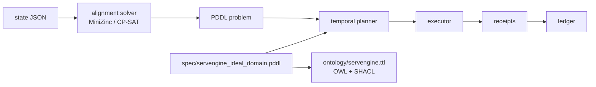

# Architecture

Autonomous facilities-management planning pipeline over the ServEngine domain.

## Components

- `spec/`: PDDL temporal domain, enterprise problem, MiniZinc alignment model.
- `ontology/servengine.ttl`: generated by `scripts/pddl_to_ttl.py` (classes from `:types`,
  predicates as properties, work-order state machine as `:Transition` rows). Deterministic.
- `Justfile` imports `justfile.d/NN-<lane>.just`; `just check` runs each lane gate.
- `receipts/<lane>.md`: line 2 is `Standing: <value>` (closed vocabulary, `just receipts-lint`).

## See Also

RUNBOOK.md
